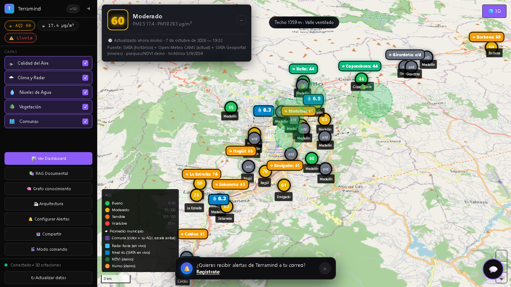
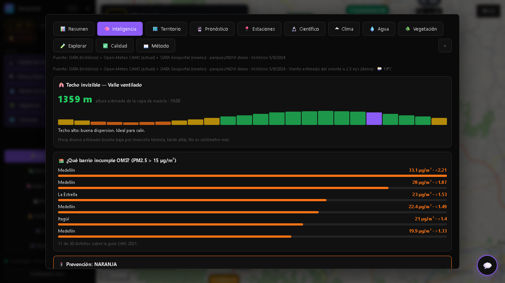
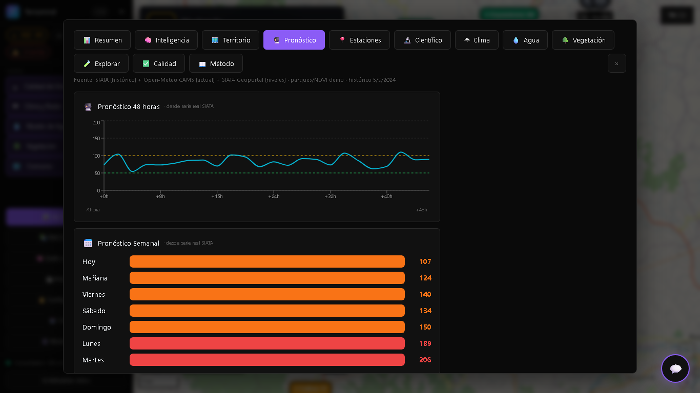
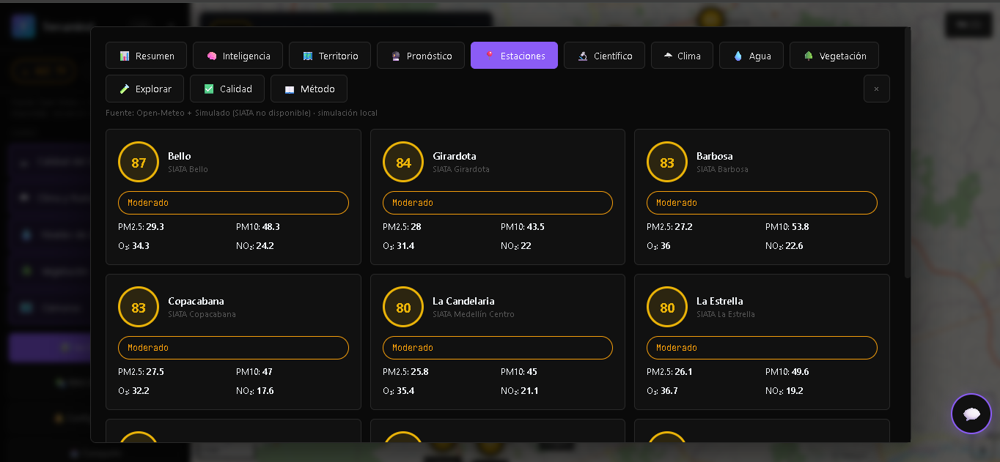
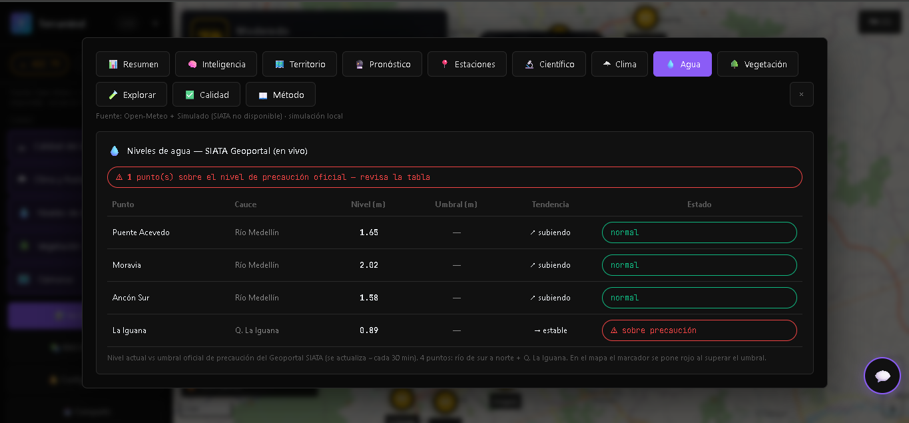
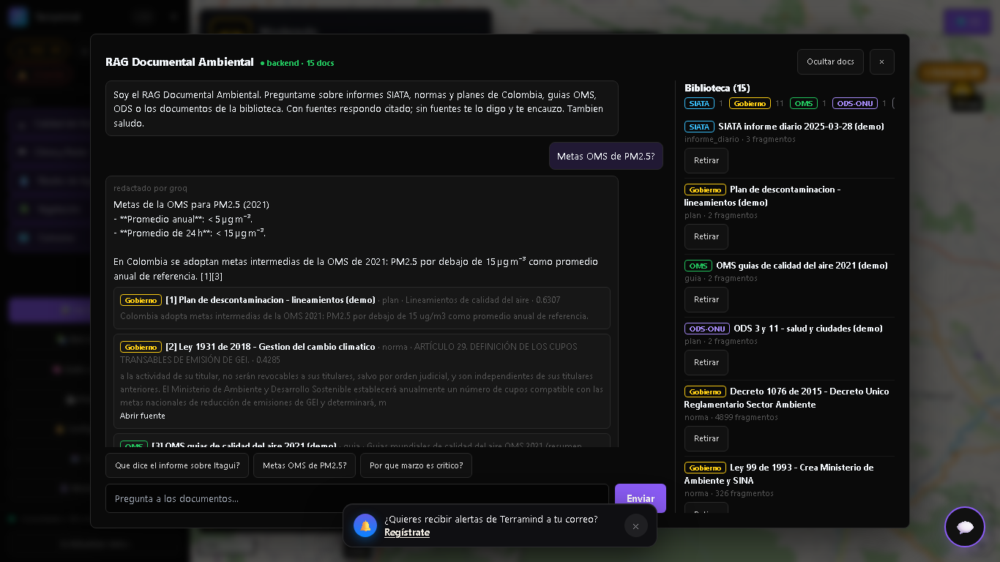

<p align="center">
  <h1 align="center">🌎 Terramind</h1>
  <p align="center">
    <strong>Environmental intelligence for Valle de Aburrá, Colombia.</strong><br>
    Interactive 3D map, live air quality data, and an AI copilot that answers with citations.
    <br>
    <a href="https://terramind-mu.vercel.app">
      
    </a>
    <a href="https://terramind-mu.vercel.app">
      
    </a>
  </p>
  <p align="center">
    
    
    
    
    
    
    
    
    
    
  </p>
</p>

---

## 🎯 El proyecto en una frase

**Copiloto IA sobre datos ambientales reales** — Mapa 3D interactivo del Valle de Aburrá con calidad del aire por comuna (SIATA) + asistente multi-LLM que responde en español citando normativa colombiana y guías OMS. Funciona en **modo demo sin API keys**.

| Problema | Solución | Resultado |
|----------|----------|-----------|
| Los datos de calidad del aire existen pero nadie los entiende | Mapa 3D auto-actualizable + copiloto IA con RAG normativo | Cualquiera consulta el aire de su ciudad sin saber de datos |

---

## 📸 Capturas de la app en vivo

| Vista | Captura |
|-------|---------|
| **Mapa 3D — AQI por comuna** |  |
| **Mapa con capas activas** |  |
| **Pestaña Inteligencia** |  |
| **Pronóstico horario + multi-día** |  |
| **Estaciones SIATA por municipio** |  |
| **Niveles río Medellín + alertas** |  |
| **Panel RAG: normas + citas + subida de archivos** |  |

> 📸 Capturadas con Playwright (1366×768) del demo vivo: [terramind-mu.vercel.app](https://terramind-mu.vercel.app)

---

## 🎥 Demo en video

[](docs/demo-terramind.mp4)
*Recorrido 60s: mapa 3D → capas aire/agua → copiloto con cita → pronóstico.*

> 🎬 Graba con el demo en vivo, guarda en `docs/demo-terramind.mp4`, súbelo a YouTube/Loom y reemplaza este link.

---

## ✨ Qué hace único a Terramind

| Característica | Detalle técnico |
|----------------|-----------------|
| 🗺️ **Mapa 3D interactivo** | MapLibre GL 4 + deck.gl 9: terreno, edificios extruidos, capas aire/clima/agua/vegetación/comunas |
| 🌫️ **Capa de datos honesta** | Dataset histórico SIATA + Open-Meteo en vivo, con **fallback demo determinístico** cuando no hay conexión — sin API keys requeridas para modo demo |
| 🤖 **Copiloto multi-LLM** | Preguntas en lenguaje natural sobre datos del valle, routing Groq / OpenRouter / Ollama, streaming SSE |
| 📚 **RAG documental** | Normas ambientales colombianas + guías OMS, respuestas con **citas verificables**, flujo subida-de-archivos-para-indexar |
| 📊 **Dashboard por capas** | 7 vistas: overview, territorio, pronóstico, estaciones, agua, inteligencia, RAG + alertas y share links |
| 🔁 **Backend FastAPI** | Endpoints `copilot`, `health`, `rag`, `spatial` con Swagger docs en `/docs` |

---

## 🛠️ Tech Stack por capa

| Capa | Tecnologías |
|------|-------------|
| **Frontend** | React 18, TypeScript 5.4, Vite 5, Tailwind CSS 3, Zustand, Recharts, MapLibre GL 4, deck.gl 9 |
| **Backend** | Python 3.11, FastAPI, Pydantic v2, multi-LLM routing (Groq, OpenRouter, Ollama) |
| **Datos** | PostgreSQL 16 + PostGIS 3.4, Redis 7, REST (SIATA, Open-Meteo) |
| **Calidad** | Vitest + Testing Library (17 suites), pytest (4 módulos), ESLint, GitHub Actions |
| **Deploy** | Docker Compose, Vercel (web), Railway/Fly.io (API) |

---

## ⚡ Quickstart — 2 minutos, modo demo

```bash
# Solo frontend, sin backend — datos simulados determinísticos
git clone https://github.com/Marusan94/Terramind.git
cd Terramind/apps/web
npm install
npm run dev
# → http://localhost:5173
```

<details>
<summary><strong>🔧 Instalación completa (backend + base de datos)</strong></summary>

```bash
# 1. Infraestructura (PostgreSQL + PostGIS + Redis)
docker compose up -d

# 2. Backend
cd apps/api
python -m venv .venv
# Windows:
.venv\Scripts\Activate.ps1
# macOS/Linux:
# source .venv/bin/activate
pip install -r requirements.txt
uvicorn app.main:app --reload --port 8000
# API docs: http://localhost:8000/docs

# 3. Variables de entorno (opcional — sin keys entra en modo demo)
cp .env.example .env
# Free keys: Groq (console.groq.com/keys), OpenRouter (openrouter.ai/keys)
```

</details>

```bash
# Tests
cd apps/web && npm test        # 17 suites Vitest
cd apps/api && pytest          # 4 módulos backend
```

---

## 💡 Cómo usar la demo en vivo

| Acción | Qué esperar |
|--------|-------------|
| **Pregunta al copiloto** | `¿Cuál es el PM2.5 ahora en Laureles y supera la norma OMS?` → respuesta citada + highlight en mapa |
| **Forecast flow** | Abre *Pronóstico* → elige una comuna → lee banda horaria + cards multi-día |
| **RAG flow** | Abre *RAG Documental* → pregunta `¿Qué dice el Decreto 1076 sobre vertimientos?` → respuesta con chunks de documento |
| **Capas** | Toggle aire / clima / agua / vegetación / comunas en el panel lateral |
| **Compartir** | Botón *Share* genera link con estado actual del mapa (comuna, capas, fecha) |

---

## 🏗️ Arquitectura

```mermaid
flowchart TD
    subgraph Frontend["React 18 + TypeScript (MapLibre + deck.gl)"]
        MAP[🗺️ 3D Map Viewport]
        COPILOT[🤖 AI Copilot]
    end

    MAP --> API
    COPILOT --> API

    subgraph Backend["FastAPI Backend"]
        API[(copilot, health, rag, spatial)]
    end

    API --> DB[(PostGIS + Redis)]
    API --> EXT[SIATA historical + Open-Meteo live]
    API --> DEMO[Demo fallback (deterministic)]
```

**Versión interactiva:** [`docs/architecture-terramind.html`](./docs/architecture-terramind.html) — explora nodos, traza rutas (`R`), scope upstream/downstream, compara roles (`L`), presenta (`F`), exporta (`E`). Fuente versionada: [`docs/architecture-terramind.json`](./docs/architecture-terramind.json).

---

## 📚 Documentación técnica

| Documento | Descripción |
|-----------|-------------|
| [01_ARCHITECTURE.md](./docs/engineering/01_ARCHITECTURE.md) | Arquitectura del sistema |
| [07_API_CONTRACT.md](./docs/engineering/07_API_CONTRACT.md) | Contrato REST API |
| [AGENTS.md](./AGENTS.md) | Guía multi-agente |
| [CONTRIBUTING.md](./CONTRIBUTING.md) | Cómo contribuir |
| [RAG ingest guide](./data/rag_library/README_INGESTA.md) | Re-indexación (RAG en memoria se reinicia al restart de API) |

---

## 🤝 Contribuir

1. Fork → branch (`feat/map: ...` / `fix/api: ...`)
2. `npm test` + `pytest` deben pasar
3. PR con screenshots para cambios de UI
4. Ver [CONTRIBUTING.md](./CONTRIBUTING.md)

---

## 📜 Licencia

Apache-2.0 — ver [LICENSE](./LICENSE).

**Datos:** SIATA (Área Metropolitana del Valle de Aburrá) · Open-Meteo · OpenStreetMap · MapLibre · deck.gl.

---

<p align="center">
  <strong>🌎 Ask the data. • 🤖 AI answers. • 🗺️ The map shows it.</strong><br>
  Built in Medellín, Colombia — by <a href="https://github.com/Marusan94">@Marusan94</a>
</p>